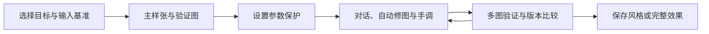

# 调色工作区产品与技术设计

状态：设计完成，已通过独立读者复核，待实施。日期：2026-10-10。

本方案覆盖六项能力：创作目标、参数保护、草稿与撤销、可复用风格保存、多样张验证、版本比较。沿用现有生成页、30 项参数、单个 33³ `.cube` 输出和账号体系。本文描述的新增行为尚未实现。

## 1. 产品目标与范围

用户能够表达希望保留的画面氛围，控制 AI 可以改动的参数，恢复每次有效操作，在多张照片上检查同一风格，并把满意的结果保存为可复用资产。

| 能力 | 当前基础 | 本次交付 |
|---|---|---|
| 创作目标 | 风格描述与固定统计诊断 | 自然校正、保留氛围、只调整风格三种模式；观察与目标冲突分别展示 |
| 参数保护 | 自动修图保留输入基准和显示映射 | 参数与分组锁定；所有参数应用入口遵循同一规则 |
| 草稿与撤销 | 会话恢复、最近一次自动修图撤销 | 本机草稿、完整操作撤销/重做、刷新恢复与写入失败反馈 |
| 可复用风格保存 | 保存完整参数 | 实际生效调整的来源记录；风格配方与完整效果分别保存 |
| 多样张验证 | 单样张预览 | 一张主样张与多张验证图；同一参数集预览与按需统计验证 |
| 版本比较 | 原图与当前 LUT 对比 | 命名版本、两版 A/B、恢复与另存版本 |

本次不包含参考图生成、外部 LUT 导入、自由曲线、RAW 解码、批量独立自动修图、相机无线连接或设备校准。这些能力不作为六项的前置依赖。

### 默认决策

- 新工作区默认使用“保留氛围”；迁移旧会话保持“自然校正”，避免改变旧工作方式。旧 API 缺少目标上下文时沿用原行为。
- 参数锁表示禁止修改。锁定后滑杆不能直接修改，用户先解除锁定。
- 当前草稿与命名版本分开；查看样张、版本与 A/B 都不会隐式恢复参数。
- 草稿和操作历史保存在当前浏览器；显式保存的风格与命名版本保存在账号中。本版不承诺草稿跨设备同步。
- 照片默认只在页面内存中保留；可选择在本机保留缩小预览，服务端不持久化照片。
- 主样张用于 AI 分析；验证图用于检查同一 LUT，不分别生成各自参数。
- `.cube` 不包含可编辑来源与相对配方语义。账号资产保留配方，下载时根据明确的参数与输入条件生成一个 LUT。

## 2. 用户流程与页面布局



生成页仍采用聊天与预览调色两栏。新增状态主要放在预览栏，聊天复用同一工作区上下文。

```text
聊天与会话                     调色工作区
                               目标 [保留氛围 ▾]   输入 [Natural ▾]
                               草稿：已保存到本机   [撤销] [重做]
                               [当前编辑] [A/B 比较] [版本]

                               预览图 / 两个版本的比较
                               正在查看：室内.jpg
                               AI 分析主样张：日光.jpg
                               [主样张 ★] [验证图] [验证图] [＋添加]
                               [设为主样张] [验证当前效果]

                               风格描述 [...] [AI 自动修图]
                               本次目标 / 锁定项 / 调整报告

                               参数组 [锁定组] [复位未锁定项]
                               冷暖 [...] 数值   [锁]
                               本次手调用途 [按参数组默认 ▾]

                               [保存] → [完整效果 / 可复用风格]
                               [保存命名版本] [下载机内版] [下载后期版]
```

窄屏时顶部工具条换行，样张条横向滚动，A/B 优先使用滑动对比。所有图像使用同一缩放与定位，避免版式差异影响判断。锁、保存状态与版本标签同时提供文字和图标。

## 3. 创作目标

### 3.1 三种模式

| 模式 | 基础校正 | 风格阶段 | 规则兜底 |
|---|---|---|---|
| 自然校正 | 按现有亮度、色偏、影调问题做克制调整 | 有风格描述时执行 | 仅在当前目标与锁允许的字段上执行 |
| 保留氛围 | 暖、冷、暗、低饱和先作为观察；不主动把曝光拉到统一中间调，也不主动消除整体暖冷倾向；可改善可测影调问题 | 执行用户明确的风格要求，保留其他氛围 | 禁止固定曝光目标与灰世界冷暖兜底；没有适用提议则保留当前参数 |
| 只调整风格 | 跳过 | 必须提供风格描述；直接以当前参数为基准 | 禁止基础校正兜底 |

“保留氛围”基础校正首版不主动调整 `exposure`、`temp`、`tint`。用户在风格描述中明确要求改变这些项目时，风格阶段可调整未锁字段。该模式不承诺完全保持所有像素亮度，只承诺不进行默认的全局曝光与冷暖归一化。

普通对话不要求上传照片；没有照片测量时，只说明提取并生成了哪些参数，不声称已经修好了照片。

### 3.2 诊断与完成状态

现有统计值继续计算，报告区分：

1. **观察**：例如“整体偏暖”“暗部占比较高”，不直接称为缺陷。
2. **与目标冲突**：例如选择自然校正后仍有明显偏暖；用于选择校正方向及判断是否完成。
3. **调整风险**：例如本次增加了高光溢出、肤色偏移或参数非法；用于应用前拒绝。

创作目标影响校正问题与收敛判断；不自动放宽现有裁剪、肤色、饱和度、曝光步长与参数范围约束。视觉复核收到同样的目标与锁定上下文，避免把有意保留的暗调或暖调再次评价为错误。

新增结果元数据 `goal_status`、`execution_status` 与 `blocked_reasons`：

- `goal_status`：`met`、`partially_met`、`unchanged`、`not_evaluated`。
- `execution_status`：`model`、`rules_only`、`failed`、`skipped`。
- 锁定导致无法继续时显示“受保护项限制，当前目标未完全完成”；模型失败与照片仍有目标冲突分别呈现。
- 旧 `degraded` 为兼容保留，由新状态映射；不能只因照片暗或暖就判为未达标。

### 3.3 AI 契约

`goal_mode` 与 `locked_fields` 放在编辑上下文，不能混进 `params`。工具仍使用现有定义：校正返回 14 个现有字段的增量；风格返回现有字段的绝对目标值；视觉复核不返回可应用参数。

校正、风格、兜底、对话应用都需要接收上下文。`diagnose_for_goal` 负责从观察选择当前目标的可修问题；`is_goal_met` 替代自动流程中固定的收敛判定。原有无上下文函数可保留默认行为供兼容调用。

“只调整风格”即使检测到照片偏暗，也不能在失败后进入自然校正兜底。没有合法提议时返回未改变结果和原因。

## 4. 参数保护

### 4.1 范围

- 支持字段级锁与分组锁；组锁展开为现有字段集合。
- `lift`、`gamma`、`gain` 各作为一个三通道字段锁定，本版不做逐通道锁。
- `base_photo_style`、`tone_map` 继续在 AI 自动修图中只读，与用户锁分开处理；取消普通锁也不能让 AI 修改这两项。
- 锁状态属于工作区，不随可复用风格自动带到另一工作区。
- 本版不增加“肤色完全不变”锁。肤色保护仍是可测效果约束；参数锁不能保证某个空间区域像素不变。

### 4.2 各入口行为

| 操作 | 行为 |
|---|---|
| 单项手调 | 锁定控件禁用，旁边保留可点击的解锁入口 |
| 对话、自动校正、风格与规则兜底 | 不得改变锁定字段；服务端最终验证 |
| 分组或全部复位 | 操作对象只包含未锁定项，显示保留了几项 |
| 应用预设、载入风格、恢复版本 | 先检查冲突；冲突时列出字段，选择取消或“解除冲突项锁定并应用”；不静默部分应用 |
| 撤销/重做 | 恢复该事务前后完整编辑状态，也可撤销锁/解锁操作；属于用户主动恢复 |
| 刷新恢复草稿 | 同时恢复参数与锁状态，不根据锁重新过滤草稿 |

请求开始时参数快照是 AI 的保护基准。提示词声明锁定项；动态工具 schema 可缩小允许字段；应用前仍验证锁定字段与基准完全一致。不得通过先合并再限幅绕过检查。

候选修改锁定项时，整个该阶段提议不应用，记录具体原因；可在现有总轮次预算内重提。风格阶段最多补提一次，避免反复消耗。合法且全部锁定字段未改变的零增量不构成冲突。没有可写字段时跳过相应阶段和调用。

运行 AI 时冻结编辑与锁定变更。响应携带请求标识和来源内容摘要，客户端应用前再次确认工作区、主样张、输入与参数快照一致；过时响应作为未应用候选，不能覆盖新状态。

## 5. 草稿、操作历史与恢复

### 5.1 三种对象

| 对象 | 是否可变 | 用途与保存位置 |
|---|---|---|
| 当前草稿 | 可变 | 当前参数、上下文、来源记录、样张引用；本机 IndexedDB |
| 操作事务 | 不可变 | 撤销/重做；记录实际生效的前后编辑状态，本机持久化 |
| 命名版本 | 参数内容不可变 | 显式保存、比较与恢复；账号存储，名称可修改 |

工作区有独立 UUID，不用固定“自动修图”会话 ID 当草稿键。聊天会话是关联记录，切换会话显式切换关联工作区。新工作区先保存旧草稿，再创建新 UUID。

首次打开旧会话或 LUT 时，完整参数作为来源基线，标记其校正/风格来源未知。已经存在的有效本机草稿优先于最后一条 AI 消息；无草稿时才从会话或资产建立初始状态。

### 5.2 自动保存

- 参数拖动即时预览，草稿写入约 500ms 合并；事务结束立即提交本机保存。
- 草稿包含名称、当前完整参数、目标、锁、用途选择、来源基线及风格配方投影、关联版本、样张元数据、格式版本与保存时间。
- 保存文案区分“保存中”“已保存到本机”“当前修改未保存”。本机草稿保存不等于保存到我的 LUT。
- 恢复前检查格式版本、用户归属、字段、范围与来源结构；非法记录不得覆盖有效状态，可导出诊断副本供排查。
- IndexedDB 写入失败保留内存编辑并显示未保存；提供重试和下载参数备份入口。备份只有参数与工作区元数据，没有照片。
- 登录过期保留本机草稿，重新登录同一账号可恢复；退出后隐藏该账号草稿，不删除。其他账号不能在界面中读取它；本机缓存不承诺对共享操作系统账号进行加密隔离。
- 同一工作区跨标签页通过 BroadcastChannel 通知 revision；检测到其他标签的更新时暂停覆盖并提供另存本机副本。IndexedDB 写入使用 revision 比较，不能只依赖通知避免竞态。

### 5.3 撤销事务

| 用户操作 | 一条事务的边界 |
|---|---|
| 拖动滑杆 | 指针按下到松开、取消、失焦；中间只更新预览 |
| 键盘连续调整 | 一次按键按下至松开；新的按键操作再建事务 |
| 一次对话 | 本次实际生效的参数及来源变化 |
| 一次自动修图 | 内部多轮、风格与兜底合并成一个用户事务；内部阶段来源仍记录 |
| 锁/解锁、切换目标 | 每次作为独立上下文事务 |
| 分组复位、载入风格、恢复版本 | 一次完整应用，包括明确同意的解锁或输入切换 |
| 换预览图、A/B 选择、移动分割线 | 查看状态，不进入编辑撤销栈 |

无有效变化不建事务。失败请求和未应用提议不建参数事务，但保留报告。撤销后新编辑清空重做分支，命名版本不删除。

本机保存最近 100 条事务。淘汰最早事务时，当前来源基线与风格配方投影必须保持完整，不能因撤销栈截断丢失更早风格贡献。刷新同时恢复草稿与历史；格式不兼容时保留可验证的当前参数，历史单独失效并提示。

自动报告绑定事务 ID、来源样张 ID 和参数摘要。手调后不删除旧报告，显示“来自此前调整”；不能继续将旧诊断标成当前结果。统一历史接管新工作区的撤销，旧自动修图撤销端点仅服务旧数据，避免一次操作被撤销两次。

## 6. 可复用风格保存

### 6.1 来源与用途

每次有效参数变更标记用途：`technical`、`correction`、`style`、`unclassified`。

- 输入基准与显示转换是 `technical`。
- 自动基础校正与规则兜底是 `correction`，即使使用对比度、曲线或 RGB 参数。
- AI 风格阶段是 `style`，即使使用曝光或冷暖。
- 对话与手调提供用途选择。默认按参数组：曝光、冷暖、绿洋红归为校正，其他创意组归为风格；用户可明确选择本次为校正或风格。
- 来源不明的旧参数是 `unclassified`；不能从字段名或最终值自动宣称已经分离了校正。

因此“参数作用于哪一层”和“用户这次为什么调”分开记录。被拦提议、无效响应和视觉复核文字均不进入风格配方。

### 6.2 配方生成

每个实际生效风格操作记录前值与后值，并编译成现有参数上的 `add` 或 `set`。两种操作是应用语义元数据，最终 `params` 仍严格使用现有 30 字段。

| 字段类别 | 默认配方语义 |
|---|---|
| 曝光、冷暖、绿洋红、对比度、饱和度、自然饱和、影调、S 曲线、目标色偏移/饱和、RGB | 保存实际前后差值为 `add`，RGB 逐通道相加 |
| 对比中心、选色中心/宽度、分离色调色相/平衡、风格强度 | 保存作用位置或形状为 `set` |
| 全局色相旋转 | 保存最短角度变化，应用后归一到合法角度区间 |
| 用户明确要固定的目标 | 保存面板可将字段改成 `set`；不根据模型文本猜测确定性用途 |

首版普通影调参数使用现有参数空间增量，不承诺物理意义上的效果等比例变化。保存面板展示配方与在同一输入基准中性参数上生成的预览，用户可调整 `add/set` 并复核。

例子：操作前 `temp=0`，校正后 `temp=600`，风格后 `temp=900`。风格保存 `add 300`；应用到已校正为 `temp=-400` 的另一工作区，目标为 `-100`。完整效果保存 `900`。不能把 `900` 当通用目标，也不能因冷暖常用于校正就清零。

### 6.3 依赖锚点

仅保存变化字段会丢失未变化的作用位置。编译配方时补齐以下依赖：

- 对比度依赖对比中心。
- 目标色偏移/饱和依赖选色中心与宽度。
- 各分离染色强度依赖对应色相，并携带平衡。
- 所有创意风格依赖风格强度；明确为 `set`，避免目标工作区的旧强度意外压低效果。

依赖取该风格操作生效时的值，标为“作用范围”，不标为新的色彩变化。保存面板按相关组选择，不能只取消依赖保留效果项。输入基准和显示映射放在输入契约中，不作为可移植风格调整。

多个已生效风格编辑按原顺序组合：连续 `add` 累加；后来的 `set` 替换该字段此前风格表达；`set` 后的 `add` 更新固定目标。锁定或越界造成整个应用失败时，不生成贡献。将历史投影压缩为字段操作前，必须验证依赖锚点与顺序的等价性；不能靠截断操作历史实现压缩。

如果不同阶段对同字段反复覆盖，保存界面展示提炼结果与当前完整效果的差异，用户可排除或改成固定目标。来源已知也不代表提炼后在原图上必然与完整效果相同。

**后续校正与复位规则：** 新的 `correction` 编辑只记录新的校正变化，不删除此前已确认的 `style` 贡献。例：校正后 600、风格后 900，再将冷暖调整到 500 并记为校正，可复用风格仍为 `add 300`；完整效果为 500。保存面板指出风格形成后又发生过校正，给出两个候选预览。

“复位”明确表示取消所选未锁字段的全部当前调整，设为参数默认值，并删除该字段的校正/风格贡献，不将“默认值减当前值”记录为新的风格。对于旧基线，同样将复位字段标为已知中性值。重算依赖：效果项已复位则移除不再被使用的锚点；仅锚点复位且效果项仍有效，则使用复位后的当前锚点。锁定项与其值保留。复位事务的撤销同时恢复参数、贡献和依赖，不能只恢复数值。

### 6.4 保存与应用

保存面板提供：

1. **完整效果**：当前完整参数，适用于来源照片或相近条件。
2. **可复用风格**：从有效风格贡献生成配方，默认排除样张校正；展示来源、作用范围和应用方式。

旧资产或未分类基线必须先确认哪些内容应作为风格保留，可以选择现有参数的固定目标；没有确认前只允许完整效果保存。没有有效风格贡献时，禁用“保存可复用风格”，不创建空风格。

“携带来源校正”会切换到完整效果用途，并明确显示适用条件。用户可同时保存两个关联资产，但不能把完整校正快照标为已经适合跨场景复用。

**保存不修改当前草稿。** 保存面板有独立候选预览，关闭后仍回到原编辑结果。下载配方时明确选择“当前草稿上的效果”或“同输入基准中性校正下的风格”；命名、保存与导出均记录选择的实际参数。

应用可复用风格时，先检查输入基准与来源显示映射、锁和数值范围，生成完整候选。信号不匹配不自动改输入；锁冲突不部分应用；越界不静默限幅，展示字段并要求调整配方或当前校正。存在主样张时沿用图像风险检查；没有图片时可以应用合法参数，标为“尚未验证图像效果”。一次应用算一条可撤销事务。

本版配方应用定义为“在当前效果上追加风格”，候选预览显示当前与追加后结果；完整快照载入定义为“替换当前完整参数”。两种动作必须使用不同文案。同一配方修订已经追加过时，提示再追加会累积，用户可取消或明确继续；不能用“预览”动作再次追加。替换某一历史风格而保留全部后续编辑不属于本版能力，可用撤销或恢复该风格前版本后再追加。

载入配方记录它实际改变的风格贡献，不能仅复制源配方的数字：锁、范围或图像检查失败时没有贡献；完整快照载入则建立新的来源基线。命名版本恢复使用该版本保存的来源与配方投影，不将“当前参数到恢复参数”的差值再次归为风格。保存的配方必须能独立应用，来源 ID 只辅助追溯；必要的前后值与依赖摘要随资产保存，不依赖本机仍有完整事务历史。

## 7. 多样张验证

### 7.1 主样张与查看图

每个工作区最多 5 张样张，其中最多一张主样张。首张自动成为主样张；点击缩略图只换查看图。另设“设为主样张”，AI 按钮始终注明分析的主样张，运行时展示该图。

更换主样张保留参数、目标与锁，并显示“当前校正来自此前样张；可对新主样张重新分析”。不会自动清零或重复校正。旧报告保留来源图标签。

删除主样张时选择已有兼容图片或进入无主样张状态。无主样张或缺少其源文件时停用自动修图；普通对话、手调与版本操作仍可使用。

每张样张记录用户确认的输入基准。文件扩展名与 EXIF 仅作提示，不可靠推断 Photo Style。STD、NAT、VIVD 不因都使用 sRGB 相对函数就被视为相同输入；V-Log 也不能由普通 JPEG 扩展名推断。

输入不匹配的样张保留在列表中并注明原因，不渲染错误试套、不进入验证结论。切换工作区输入后，重新计算兼容状态，不把旧样张重新解释为新信号。

直接切换输入基准或修改显示映射时，当前数值与已确认风格贡献保留，但原投影仍带有旧输入契约，标为“待按新输入确认”，不能自动换契约并保存为可复用风格。完整效果仍可保存。用户需选择当前基准的兼容样张，在保存候选中重新预览并明确确认配方与依赖，才建立新契约；这表示用户复核了新输入下的效果，不表示完成了设备校准。期间新编辑保留各自来源，整份配方确认前保持待确认状态。一次技术参数操作结束时提交该变化、投影状态与验证失效，撤销一并还原。载入完整快照或恢复版本使用其已保存契约与来源，无需按直接切换规则重复重建。

### 7.2 验证行为

- 所有兼容图都预览同一份完整参数，主样张与验证图不拥有各自的一套参数。
- 当前大图优先渲染，缩略图按需缓存；不同时创建五个完整 WebGL 渲染器。
- 点击“验证当前效果”后，对最多五张兼容图运行确定性统计，不调用 LLM。
- 对比同图的技术基线与当前效果，显示亮暗部裁剪变化、亮度分布及有足够样本时的肤色变化。V-Log 技术基线保留显示转换，照片线使用相同输入基准的中性参数；报告注明基线定义。
- 用“待关注”“暂未发现新增风险”“无法测量”表述，不将统计通过称为艺术质量合格。
- 结果绑定参数摘要、引擎版本、样张摘要与输入契约；编辑参数后标为过期，可再次验证。换查看图不使同一验证集失效。
- 验证来源同时记录源图摘要（可用时）、实际参与测量的预览像素摘要、尺寸、颜色解码/缩小规则版本，以及“源文件生成预览”或“本机恢复预览”。重新编码、重选文件或测量尺寸改变后重新验证，不复用旧结论。缩小预览只用于此分辨率上的指标，不能声称检查了原始像素级细节。
- 多图结果用于发现适用条件，不按五张图的问题数自动平均生成一组新参数。

### 7.3 照片与容量

上传沿用单图 32MB 和既有像素预检，预览最长边 2048。原始文件在本页内存中保存供主图自动修图使用，不随草稿、版本或 LUT 上传存储。

“在本机保留样张预览”默认关闭。开启后只保存缩小预览，单工作区合计不超过 24MB、7 天过期，提供清除入口。达到容量或写入失败时，参数继续保存，图片显示未保留状态；不得显示全部草稿已完整恢复。

刷新后仅有缩小预览时可以继续看效果和做统计验证；自动修图需重新选择来源文件。文件摘要与已记录源图一致才重新绑定，不一致则作为新样张。云端命名版本只保存图片引用与验证摘要，不保存像素。

现有“照片不会保存”的文案需改为明确区分服务端与可选本机缓存；视觉复核仍单独说明图像发送用途。统计验证关闭视觉复核，也不会因此发送图片给模型。

## 8. 命名版本与 A/B 比较

### 8.1 版本内容

显式保存命名版本包含完整参数、创作目标、锁状态副本、配方/来源、输入契约、引擎与格式版本、创建时间及可选验证摘要。每个工作区最多 20 个命名版本，达到上限提示管理，不自动覆盖。

参数内容不可变。重命名不改变内容；继续编辑后“另存版本”生成新版本。更新已有 LUT 时记录新的资产修订，不能修改已保存版本引用的历史参数。

### 8.2 比较

- A、B 可选择命名版本或“当前草稿快照”。草稿快照在选择时固定，用户点“更新草稿快照”才刷新。
- 两版使用同一张兼容样张、同一预览尺寸、缩放和分割位置，标明名称与时间。
- 只有输入基准与输出编码相同的版本允许直接 A/B；显示映射不同可以比较，但在标签中注明其数值。
- 比较页面只读。退出回到当前编辑参数；进入、换版本、换图、移分割线都不触碰编辑历史。
- 版本差异按参数组显示，包含输入/显示映射、曝光与 RGB 数组，不只显示创意项。
- 无图片时允许查看参数差异，图像区提示选择兼容样张。

### 8.3 恢复

“恢复此版本”为独立按钮：先计算输入变化与当前锁冲突；无冲突直接恢复，有冲突提供取消或解除冲突锁后完整恢复。版本附带锁副本用于查看，不自动覆盖当前锁。

跨输入恢复需明确确认输入切换；已有照片仍保留原标签，没有匹配主图则进入待选主图状态。恢复参数、目标、输入及用户明确选择的解锁作为一个事务，可完整撤销。未变内容不新建事务。

同时恢复该版本的来源基线与风格配方投影，保证后续继续编辑、撤销和提炼风格有确定依据。样张元数据仅作来源提示，不替换本机已有图片，不自动把来源照片设为仍可用的主样张。缺失的照片标为待重新选择。

版本原件始终保持不变。恢复后标为“基于某版本编辑”；保存新版本需要新的明确动作。

## 9. 数据与接口契约

### 9.1 概念模型

| 对象 | 核心内容 |
|---|---|
| `WorkspaceDraft` | UUID、用户/会话关联、revision、完整参数、目标、锁、名称、来源基线、风格配方投影、样张引用 |
| `EditTransaction` | 操作来源、前后编辑状态、实际生效阶段、用途、报告引用、时间；无图片字节 |
| `StyleRecipe` | 格式版本、输入契约、现有字段上的 add/set、依赖与来源；不包含独立新调色参数 |
| `SampleRef` | UUID、文件摘要、名称、用户确认输入、主图标识、本机源文件/预览可用性 |
| `ValidationRun` | 参数与样张摘要、引擎版本、测量基线、逐图统计、缺测原因 |
| `NamedVersion` | 不可变完整参数与配方快照、编辑上下文副本、输入与可选验证摘要 |

风格配方示例：

```json
{
  "format_version": 1,
  "kind": "portable_style",
  "input_contract": {"base_photo_style": "NAT", "output_encoding": "sRGB", "tone_map": 1.0},
  "operations": {
    "temp": {"mode": "add", "value": 300.0},
    "contrast": {"mode": "add", "value": -0.15},
    "contrast_pivot": {"mode": "set", "value": 0.462, "dependency": true},
    "look_strength": {"mode": "set", "value": 1.0, "dependency": true}
  },
  "source": {"workspace_id": "uuid", "transaction_ids": ["uuid"]}
}
```

配方键集合、锁字段集合、依赖关系和最终参数均由既有参数定义与显式依赖表验证。不同配方操作的值不能直接套用绝对值范围校验：例如 `gamma add` 是增量；必须验证操作类型、有限数及应用后的绝对目标范围。数组仍为三通道。`base_photo_style`、`tone_map` 不允许出现在可移植 operations 中。

### 9.2 存储职责

- IndexedDB：草稿、最近 100 条事务、查看状态与可选预览缓存；按用户和工作区隔离。
- MySQL：工作区身份/会话关联、命名版本、风格资产和修订、报告与验证摘要；不保存照片。
- 本页内存：源文件、当前渲染器、运行请求和比较快照。
- 本版不把每一次拖动上报服务端，也不增加云端草稿同步。

资产表兼容旧 `params_json`：增加 `kind`、`recipe_json`、输入契约、来源及修订信息；旧记录标为完整效果。新工作区身份表只承担关联与归属，不作为在线可变参数的权威状态。命名版本及资产修订独立保存，用户删除会话时需要展示关联版本，选择保留资产或一并删除工作区版本。

### 9.3 API 变化

| 接口职责 | 设计 |
|---|---|
| 工作区身份 | 新增账号下工作区的创建/关联接口；所有资源校验归属 |
| 对话 | 现有请求增加可选 workspace/context 与来源内容摘要；返回实际变更与用途元数据 |
| 自动修图 | 现有 multipart 增加可选 workspace/context、主图 ID、来源摘要；报告关联当前工作区，不再强制切到固定自动会话 |
| 多图验证 | 新增一次最多五张图片的统计验证接口；只计算，不调用模型、不持久化图片 |
| 命名版本 | 新增创建、列表、读取、改名与删除；内容不可变，无更新参数接口 |
| 保存资产 | 扩展原 LUT 保存/更新，支持完整效果与可复用配方；服务端重新验证配方及候选参数 |
| 下载 | 参数化导出行为保持；配方下载需携带明确的目标参数或选择中性校正，不能模糊取某份旧参数 |

请求与响应增加的元数据不进入 `LutParamsModel`。老客户端仍可使用原接口；旧自动会话与最近报告保留可读。新客户端进入工作区后统一使用新事务与来源语义，不能把旧全局报告恢复进无关草稿。

统计验证首版同步返回，沿用上传预检并增加总字节预算、并发/按用户限流；五图顺序处理或小并发，不能将五份原图无上限同时展开。接口返回逐图失败，不因一张不兼容图丢掉其余结果。

## 10. 模块与实现任务

| 任务 | 主要改动 | 依赖 | 交付验收 |
|---|---|---|---|
| 统一编辑模型 | 前端工作区 reducer/store、参数事务与查看状态分离 | 参数契约 | 所有参数入口能产生同一种实际生效事务 |
| 草稿与操作历史 | IndexedDB、revision 冲突、滑杆事务、撤销/重做、备份 | 编辑模型 | 刷新恢复、一次拖动一条记录、100 条边界不丢配方 |
| 目标与锁 | 上下文 schema、目标判定、四条 AI/规则路径的约束、UI 状态 | 编辑模型 | 三模式与锁的端到端验证，旧接口行为兼容 |
| 来源与配方 | 各阶段来源、手调用途、配方编译、依赖、保存候选预览 | 编辑模型、目标与锁 | 同字段分离正确，保存不改草稿，旧资产需确认 |
| 样张与验证 | 样张条、主图选择、输入标签、本机预览选项、统计接口 | 编辑模型、目标与锁 | 一套参数多图预览，结果过期及隐私语义正确 |
| 版本与比较 | 版本存储、参数差异、A/B 渲染、锁/信号恢复检查 | 编辑模型、样张、配方 | 比较零编辑副作用，恢复是一条完整事务 |
| 兼容与联调 | 新旧会话/资产迁移、导出、状态与报告关联、文案 | 以上任务 | 原有生成/导出回归，六项完整流程通过 |

实现先建立编辑模型、草稿与撤销，再实现目标与锁；其后配方、样张验证可并行，版本比较接在统一快照模型上。每项实现前更新对应详细接口定义，完成后独立复核。

建议模块：前端 `workspace` 管理状态与事务，`draftStorage` 管理本机持久化，`styleRecipe` 管理来源投影，`sampleGallery` 管理样张，比较组件只读消费快照。后端编辑策略、配方验证与照片统计继续分别归属 agent、参数/配方领域层、photo；HTTP 层负责归属与持久化协调。此处是职责建议，最终文件拆分以实现接口为准。

## 11. 验收场景

### 创作目标与保护

- 夕阳暖调、低调夜景在“保留氛围”下不会由固定曝光/灰世界兜底归一；报告把暖暗列为观察。
- 自然校正仍处理现有问题；只调整风格在描述为空、模型失败或提议被拦时都不会自动校正。
- 锁定曝光与 RGB 后，对话、优化、风格、规则兜底及载入配方都不能绕过；非法工具输出被拒。
- 所有可写字段受保护时跳过相应模型调用，显示限制原因。
- 风格要求与锁冲突、参数越界或图像风险冲突分别报告；创作目标不能绕过硬校验。

### 草稿与来源

- 手调后刷新恢复参数、目标、锁、名称与历史；照片未留存时明确要求重新选择源文件。
- 一次滑杆几十次更新只有一条撤销；键盘、失焦与手势取消行为一致。
- 一次多轮自动修图只需撤销一次；有效风格贡献与报告绑定随事务一起恢复。
- 撤销后编辑清空重做，但不删除命名版本；超过历史容量后配方贡献仍完整。
- 写入失败不显示已保存；同一工作区两个标签页不会静默互相覆盖。

### 风格保存

- 校正 `temp 0→600`、风格 `600→900` 得到 `add 300`，应用在 `-400` 上结果为 `-100`。
- 对比中心、选色范围或染色色相未变化时，依赖仍随风格保存；数组增量与固定目标正确。
- 后续校正保留此前风格贡献；复位删除选中字段贡献并重算依赖；两者撤销都恢复正确来源，不能生成反向风格。
- 保存候选预览与保存动作不改变草稿、锁、撤销栈；被拒提议不进入配方。
- 来源未知的旧 LUT 不能自动标为已提炼风格；启用携带校正后明确变为完整效果。
- 配方应用越界与锁冲突时不静默裁切或部分应用；风格下载的数值与选择的导出参数一致。

### 样张与版本

- 换查看图不改变参数或 AI 主图；设为主图不自动重复校正；旧报告注明旧来源。
- 相同 LUT 作用于多图；输入不匹配图不被错误试套；验证结果在参数变化后过期。
- 直接改变输入基准/显示映射后，原风格契约待确认，不能自动改成新契约；复核确认及撤销能恢复对应状态。
- 默认无照片跨刷新留存；本机预览开启、到期、清除与容量失败行为一致；源文件缺失时不能误用旧文件做 AI 分析。
- A/B 查看、换图和分割线操作不产生编辑事务；退出回到原草稿。
- 两版输入不同不能直接比较；恢复版本需确认输入与锁冲突，撤销可回到恢复前状态。
- 原版本内容不可变；最多 20 份不自动覆盖；名称变化不改变已引用参数。

### 质量验证

沿用现有参数契约、前后端数学与 `.cube` 一致性检查。新增纯状态/配方测试、服务端锁与目标编排测试、浏览器关键流程测试，并用经许可的夕阳、夜景、人像、植被与室内真实样张人工核对结果。统计通过与用户愿意使用分别评估，不以纯桩测试替代效果评估。

## 12. 发布与观察

按工作区能力逐步开放；旧资产不改写数值，旧会话仍可查看。引擎版本改变后，命名版本保留原参数与版本信息，图像验证标记需重做；本版不承诺仅凭参数永远复现旧引擎的逐字节输出。

关注草稿写入失败率、恢复成功率、锁冲突率、目标模式下的结果接受/撤销情况、多图风险提醒、配方应用失败和保存/导出完成率。不收集照片像素，不因指标采集增加模型调用。

本方案扩展旧 UI 文档中曾暂缓的操作历史与多图范围：操作历史负责可撤销的编辑状态，多样张负责验证一个 LUT 的适用性。它们与聊天记录、批量为每张照片自动优化分别承担不同职责。
